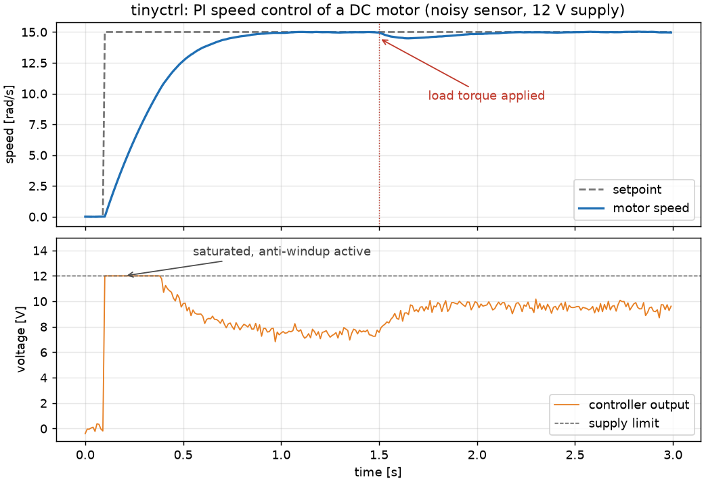

# tinyctrl

[](https://github.com/TWadi/tinyctrl/actions/workflows/ci.yml)
[](LICENSE)


**A tested control toolbox for microcontrollers, in plain C99.** PID with anti-windup, Tustin discretisation,
biquad filters, lead/lag compensators and low-pass filters. No dynamic memory, no dependencies beyond `<math.h>`,
and the numerical modules are checked sample by sample against independent reference data.



*[`examples/motor_speed.c`](examples/motor_speed.c): a PI controller drives a simulated DC motor from a 12 V
supply. The output saturates during the step and anti-windup keeps the response free of overshoot; a load torque
at 1.5 s is rejected within half a second. The noisy speed sensor is cleaned up with `tc_lowpass`.*

## Why tinyctrl?

A lot of embedded PID code is copied from a forum post: no anti-windup, a derivative kick on every setpoint change,
an ad-hoc discretisation and no tests. tinyctrl does the textbook things properly and proves it:

- **Correct discretisation.** Controllers and filters are designed in the s-domain and discretised with the
  Tustin method, optionally prewarped. The results match `c2d(..., 'tustin')`.
- **A PID you can put on a real actuator.** Conditional-integration anti-windup, derivative on the measurement with
  a first-order filter (no derivative kick), output limits and bumpless transfer.
- **Robust against bad samples.** A NaN or infinite reading is ignored instead of poisoning the integrator or filter
  state forever, and every block starts without a start-up transient.
- **Tested.** 55 unit tests, run in single and double precision. The responses of the PID, filters and compensators
  and the Tustin coefficients are compared with reference data from SciPy, an implementation independent of
  tinyctrl; the other tests cover anti-windup, resets, start-up, invalid input and argument checks.
- **Made for microcontrollers.** C99, no `malloc`, no global state, `float` by default for hardware FPUs.
  Coefficients are computed once at initialisation; the update functions are a handful of multiply-adds. CI links
  the library for Cortex-M0, Cortex-M4F and AVR with `-Wconversion -Wdouble-promotion -Werror`.

## Quick start

```c
#include "tinyctrl/tinyctrl.h"

static tc_pid speed_ctrl;

void control_init(void)
{
    const tc_pid_config cfg = {
        .kp = TC_R(2.5),      /* proportional gain */
        .ki = TC_R(10.0),     /* integral gain [1/s] */
        .kd = TC_R(0.0),      /* derivative gain [s] */
        .tf = TC_R(0.0),      /* derivative filter time constant [s], >= ts / 2 when kd != 0 */
        .ts = TC_R(0.001),    /* sample time [s] */
        .out_min = TC_R(-12.0),
        .out_max = TC_R(12.0),
    };

    if (tc_pid_init(&speed_ctrl, &cfg) != TC_OK)
    {
        /* a parameter is out of range */
    }
}

/* Called every 1 ms, for example from a timer interrupt. */
void control_step(void)
{
    const tc_real voltage = tc_pid_update(&speed_ctrl, read_setpoint(), read_speed());
    set_motor_voltage(voltage);
}
```

`tc_real` is `float`, or `double` when `TINYCTRL_USE_DOUBLE` is defined, and `TC_R()` writes a literal of that type.

Designing a filter in the s-domain and running it on the target:

```c
/* 2nd-order low-pass, wn = 2*pi*50 rad/s, zeta = 0.7, sampled at 1 kHz */
const tc_real wn = TC_R(314.159);
const tc_real num[3] = {TC_R(0.0), TC_R(0.0), wn * wn};
const tc_real den[3] = {TC_R(1.0), TC_R(1.4) * wn, wn * wn};
tc_biquad_coeffs c;
tc_biquad lowpass;

tc_tustin(num, den, TC_R(0.001), TC_R(0.0), &c); /* last-but-one argument: prewarp frequency, 0 = none */
tc_biquad_init(&lowpass, &c);
/* ... every sample: */
const tc_real filtered = tc_biquad_update(&lowpass, raw);
```

## Modules

| Header | What it does |
|---|---|
| [`tc_pid.h`](include/tinyctrl/tc_pid.h) | PID controller: trapezoidal integration, filtered derivative on the measurement, output limits with anti-windup, bumpless reset |
| [`tc_discretize.h`](include/tinyctrl/tc_discretize.h) | `tc_tustin()`: continuous transfer function (order <= 2) to biquad coefficients, with optional prewarping |
| [`tc_biquad.h`](include/tinyctrl/tc_biquad.h) | Second-order IIR section in transposed direct form II, with steady-state reset |
| [`tc_leadlag.h`](include/tinyctrl/tc_leadlag.h) | Lead/lag compensator `gain * (s/wz + 1) / (s/wp + 1)` |
| [`tc_lowpass.h`](include/tinyctrl/tc_lowpass.h) | First-order low-pass filter (exponential smoothing) from a time constant, cutoff frequency or smoothing factor |
| [`tinyctrl.h`](include/tinyctrl/tinyctrl.h) | Includes everything |

Every `*_init` function validates its arguments and returns `TC_OK` or `TC_ERR_ARG`. The `*_update` functions never
fail: a NaN or infinite input makes them return their previous output and leave the state unchanged. Without a
reset, each block takes its initial state from its first sample, so it starts without a transient; the `*_reset`
functions set another starting point. [docs/theory.md](docs/theory.md) explains the math behind each module and
these rules in detail, including the precision limits of float builds.

## Footprint

Flash per function and RAM per instance with `-Os`, measured from a linked firmware image
([`tools/footprint.c`](tools/footprint.c)). Cortex-M4F: arm-none-eabi-gcc 13.2, hardware single-precision FPU.
ATmega328P: avr-gcc 7.3, 8-bit, no FPU. Function sizes exclude shared C library and soft-float routines.

| Function | Cortex-M4F | ATmega328P |
|---|---:|---:|
| `tc_pid_update` | 208 B | 564 B |
| `tc_biquad_update` | 112 B | 272 B |
| `tc_leadlag_update` | 4 B (calls the biquad) | 4 B |
| `tc_lowpass_update` | 64 B | 144 B |

| Instance | Cortex-M4F | ATmega328P |
|---|---:|---:|
| `tc_pid` | 48 B | 46 B |
| `tc_biquad`, `tc_leadlag` | 36 B | 34 B |
| `tc_lowpass` | 12 B | 10 B |

The initialisation functions are larger, and `tc_tustin()` (used by `tc_leadlag_init()`) and `tc_lowpass_init()` /
`tc_lowpass_init_cutoff()` call `tan()` and `exp()` in double precision, which a single-precision FPU has to
emulate. On a Cortex-M4F, a PID, a low-pass filter, a notch biquad and a lead compensator with coefficients computed
on the target add about 12 KB to an otherwise empty image. With the coefficients computed offline and loaded with
`tc_biquad_init()` and `tc_lowpass_init_alpha()`, the PID, low-pass and notch add about 1.3 KB. CI links both
variants for Cortex-M0, Cortex-M4F and AVR and reports the sizes in the job summary.

## Validation

[`tools/gen_reference.py`](tools/gen_reference.py) generates [`tests/reference/reference_data.h`](tests/reference/reference_data.h)
with SciPy (`scipy.signal.bilinear`, `lfilter`): Tustin coefficients for six systems (low-pass with and without
prewarping, notch, lead, PI, static gain), and 200-sample responses of two PID controllers, two lead/lag
compensators, the low-pass filter and a notch biquad to the same test signal (two sines plus steps).
[`tools/gen_reference.m`](tools/gen_reference.m) produces the same file with MATLAB's Control System Toolbox
(`c2d`, `pid`, `filter`). `tc_tustin()` is additionally checked against the continuous frequency response at the
warped frequencies, for second-order, first-order and prewarped systems.

The comparisons allow a relative error of 2e-4 in float builds and 1e-9 in double builds (an absolute error of the
same size for values below 1). CI runs the tests with GCC and Clang on Linux, Clang on macOS and MSVC on Windows,
each in float and double and in Debug and Release builds, and with AddressSanitizer and UndefinedBehaviorSanitizer
in both precisions.

## Building and testing

```sh
cmake -S . -B build
cmake --build build
cd build && ctest --output-on-failure
./examples/motor_speed > motor_speed.csv   # plot with tools/plot_example.py
```

| CMake option | Default | Meaning |
|---|---|---|
| `TINYCTRL_USE_DOUBLE` | `OFF` | Use `double` instead of `float` |
| `TINYCTRL_BUILD_TESTS` | `ON` when top level | Build the unit tests (fetches [Unity](https://github.com/ThrowTheSwitch/Unity)) |
| `TINYCTRL_BUILD_EXAMPLES` | `ON` when top level | Build the examples |
| `TINYCTRL_WARNINGS_AS_ERRORS` | `OFF` | Compile tinyctrl's own targets with `-Werror` / `/WX` (CI turns it on) |
| `TINYCTRL_SANITIZE` | `OFF` | AddressSanitizer + UndefinedBehaviorSanitizer (GCC/Clang) |

## Using tinyctrl in your project

- **Copy the files.** Add `src/*.c` to your build and `include/` to the include path. That is all an embedded
  project (STM32CubeIDE, MCUXpresso, plain Makefiles, ...) needs.
- **CMake:**
  ```cmake
  include(FetchContent)
  FetchContent_Declare(tinyctrl GIT_REPOSITORY https://github.com/TWadi/tinyctrl.git GIT_TAG v0.1.0)
  FetchContent_MakeAvailable(tinyctrl)
  target_link_libraries(your_firmware PRIVATE tinyctrl::tinyctrl)
  ```
  An installed copy (`cmake --install build`) is found with `find_package(tinyctrl 0.1 REQUIRED)`.
- **PlatformIO:** add `https://github.com/TWadi/tinyctrl.git` to `lib_deps`.

Two build settings matter:

- **`TINYCTRL_USE_DOUBLE` must be the same for the library and every file that includes its headers**, because it
  changes the layout of every tinyctrl struct. The CMake target propagates it automatically; when copying the files
  or using PlatformIO, define it globally (for example in `build_flags`).
- **Do not compile tinyctrl with `-ffast-math`.** It lets the compiler assume that NaN and infinity never occur and
  remove the checks for them, so the sources stop with an `#error`. Add `-fno-finite-math-only` for tinyctrl's
  files if the rest of your project needs fast math.

## Roadmap

- Fixed-point (Q15/Q31) variants for microcontrollers without an FPU
- Two-degree-of-freedom PID (setpoint weighting) and back-calculation anti-windup
- Cascades of biquads and discretisation of higher-order systems
- Hardware examples on a Raspberry Pi Pico and an STM32 Nucleo board
- Arduino library packaging

## Contributing

Issues and pull requests are welcome; see [CONTRIBUTING.md](CONTRIBUTING.md).

## License

MIT, see [LICENSE](LICENSE).
